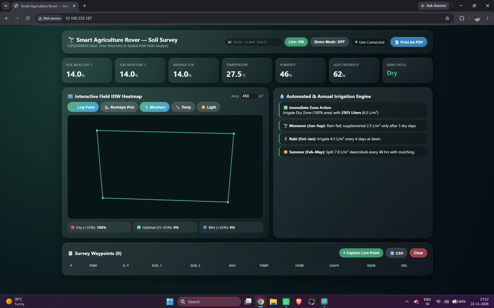
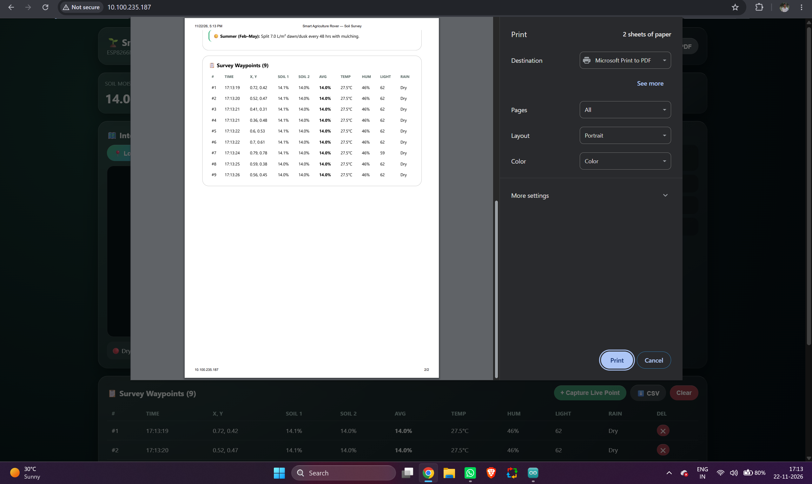
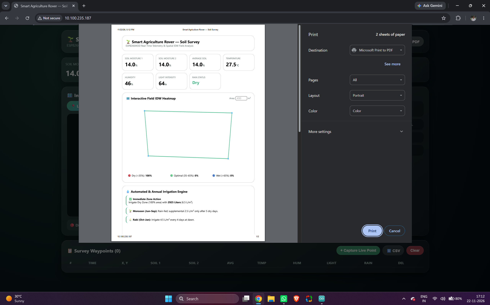

# 🌱 Smart Agriculture Rover

An IoT-based Smart Agriculture Rover designed to monitor environmental and soil conditions using an ESP8266 NodeMCU and multiple sensors.

## 🚀 Project Overview

The Smart Agriculture Rover collects real-time agricultural data and displays it through a web-based dashboard. It uses multiple sensors to monitor soil moisture, temperature, humidity, light intensity, and rainfall.

## 🛠️ Hardware Components

- ESP8266 NodeMCU V3
- ADS1115 16-bit ADC
- DHT22 Temperature and Humidity Sensor
- BH1750 Light Intensity Sensor
- Soil Moisture Sensors (2)
- Rain Sensor
- 16×2 I2C LCD Display

## 💻 Software & Technologies

- Arduino IDE
- Embedded C/C++
- ESP8266 Wi-Fi
- HTML, CSS and JavaScript (web dashboard)

## 📊 Features

- Real-time environmental monitoring
- Dual soil moisture monitoring
- Rainfall detection
- Light intensity measurement
- Web-based monitoring dashboard
- JSON data endpoint at `/data`
- LCD-based sensor readings

## 📁 Project Structure

```text
smart-agriculture-rover/
├── README.md
├── .gitignore
├── docs/
│   ├── circuit_diagram.png
│   └── dashboard_preview.jpg
└── firmware/
    └── smart_agri_rover/
        └── smart_agri_rover.ino
```

## ⚙️ Setup

1. Install the Arduino IDE.
2. Install the ESP8266 board package.
3. Install the required sensor libraries.
4. Open `firmware/smart_agri_rover/smart_agri_rover.ino`.
5. Configure your Wi-Fi credentials in the firmware.
6. Select the correct ESP8266 board and COM port.
7. Upload the firmware to the NodeMCU.

**Note:** Do not upload your actual Wi-Fi password or private credentials to GitHub.

## 🌐 Web Interface

Connect to the same network as the NodeMCU and open its IP address in a browser to access the dashboard.

The `/data` endpoint provides sensor readings in JSON format.

## 👨‍💻 Developer

**Manikantha Gowda**

GitHub: https://github.com/Mgfx05

---

*Smart Agriculture Rover – IoT-based Agricultural Monitoring System.*
# Smart Agriculture Rover — Environmental Telemetry & Spatial Soil Survey System

An IoT-enabled **Smart Agriculture Rover** environmental monitoring and spatial soil survey subsystem built on the **ESP8266MOD NodeMCU V3**. The system collects multi-sensor field telemetry (dual capacitive soil moisture probes, ambient temperature, relative humidity, light intensity, and rainfall detection), displays rotating field metrics on an onboard **16×2 I2C LCD**, and serves a **Liquid Glass Web Dashboard** featuring real-time Inverse Distance Weighting (IDW) spatial heatmaps, automated irrigation recommendations, CSV export, and A4 PDF report generation.

---

## 1. Live System Demonstration & Screenshots

### Real-Time Web Dashboard & Spatial IDW Heatmap

| Initial Field Boundary View (`http://10.100.235.187`) | Active Spatial IDW Heatmap (9 Logged Waypoints) |
| :---: | :---: |
|  |  |
| *Live ESP8266MOD connection (`Live: ON`, `Demo Mode: OFF`), 7 sensor cards, and custom field polygon (`450 m²`).* | *9 survey waypoints logged across a `300 m²` plot with live IDW moisture interpolation (`100% Dry <35%`) and irrigation volume calculation (`1950 Liters` at `6.5 L/m²`).* |

### A4 PDF Survey Report Export (`Print A4 PDF`)

| A4 Report Page 1 — Telemetry, IDW Map & Directives | A4 Report Page 2 — Seasonal Guide & Waypoint Table |
| :---: | :---: |
|  |  |
| *Print-formatted A4 sheet capturing live sensor readings, high-resolution IDW heatmap, zone breakdown, and immediate irrigation action.* | *Continuation page containing the summer split-watering schedule and full timestamped 9-waypoint tabular log.* |

<details>
<summary><strong>View Baseline A4 Print Preview (Pre-Survey Plot)</strong></summary>
<br />



</details>

---

## 2. System Architecture & Key Features

* **Multi-Channel 16-Bit Analog Acquisition:** Uses an **ADS1115 (`0x48`)** I2C ADC to read two capacitive soil moisture sensors (`A0`, `A1`) and a YL-83 rain sensor (`A2`) simultaneously on the single-ADC ESP8266.
* **Shared I2C Sensor & Display Bus:** Combines the **ADS1115 (`0x48`)**, **BH1750 (`0x23`)** ambient light sensor, and **16×2 I2C LCD (`0x27`)** on two pins (`D2` SDA, `D1` SCL).
* **Digital Microclimate Sensing:** Reads ambient temperature (°C) and relative humidity (%) via a 3-pin **DHT22** module on `D5`.
* **Embedded Liquid Glass Web Server (`PROGMEM`):** Serves a compact, memory-safe web dashboard directly from the ESP8266MOD flash memory with `Live: ON` and `Demo Mode: ON/OFF` switching, polling `/data` every 2 seconds.
* **Interactive Field Polygon & IDW Heatmap:** Supports clicking inside the custom land boundary to log waypoints, reshaping plot vertices, switching between **Moisture**, **Temp**, and **Light** layers, and exporting survey data to `.csv`.
* **Agronomic & Annual Irrigation Engine:** Computes zone-by-zone water demand (`6.5 L/m²` deficit restoration), enforces a rain-delay lock when rainfall is detected, and provides Kharif, Rabi, and Zaid seasonal schedules.

---

## 3. Bill of Materials (Hardware)

| Component | Model / Variant | Interface / Address | Purpose |
| :--- | :--- | :--- | :--- |
| **Microcontroller** | ESP8266MOD NodeMCU V3 | Wi-Fi / I2C / GPIO | Main telemetry controller & web server |
| **16-Bit ADC Module** | ADS1115 (`HW-198`) | I2C (`0x48`) | Reads Soil 1, Soil 2, and Rain analog channels |
| **Soil Moisture Sensors (×2)** | Capacitive Soil Sensor V2.0.0 (`HW-390`) | Analog (`0–3.3V`) | Dual-zone root moisture measurement |
| **Temp & Humidity Sensor** | DHT22 (3-Pin PCB w/ pull-up) | Digital Single-Wire (`D5`) | Ambient temperature (°C) & relative humidity (%) |
| **Light Intensity Sensor** | BH1750 (`GY-302`) | I2C (`0x23`) | Ambient illuminance in Lux (`lx`) |
| **Rain Sensor** | YL-83 Plate + LM393 Comparator | Analog (`AO` → `A2`) | Rainfall detection & surface wetness percentage |
| **Onboard Display** | 16×2 Character LCD + PCF8574 Backpack | I2C (`0x27`) | 3-page rotating field display & IP readout |

---

## 4. Circuit Diagram & Pinout


| Module | Module Pin | NodeMCU Pin | Notes |
| :--- | :--- | :--- | :--- |
| **ADS1115 (`HW-198`)** | `VDD` / `GND` / `ADDR` | `3V` / `G` / `G` | `ADDR` tied to `G` sets I2C address `0x48` |
| | `SCL` / `SDA` | `D1` / `D2` | Shared I2C bus (`GPIO5` / `GPIO4`) |
| | `A0` / `A1` / `A2` | Soil 1 / Soil 2 / Rain `AO` | `A3` left unconnected |
| **Soil Sensor 1 & 2** | `VCC` / `GND` / `AOUT` | `3V` / `G` / ADS `A0`, `A1` | 3.3V excitation |
| **Rain Sensor (`LM393`)** | `VCC` / `GND` / `AO` | `3V` / `G` / ADS `A2` | 3.3V excitation (`DO` unused) |
| **BH1750 (`GY-302`)** | `VCC` / `GND` / `ADO` | `3V` / `G` / `G` | `ADO` tied to `G` sets I2C address `0x23` |
| | `SCL` / `SDA` | `D1` / `D2` | Shared I2C bus |
| **DHT22 (3-Pin PCB)** | `+` / `-` / `OUT` | `3V` / `G` / `D5` | `GPIO14` |
| **16×2 I2C LCD** | `VCC` / `GND` | `VU` (5V) / `G` | I2C address `0x27` |
| | `SCL` / `SDA` | `D1` / `D2` | Shared I2C bus |

---

## 5. Setup & Deployment

1. **Arduino IDE Configuration:**
   * Select **Board:** `NodeMCU 1.0 (ESP-12E Module)` at `115200` baud.
   * Install libraries: `Adafruit ADS1X15`, `DHT sensor library`, `BH1750`, and `LiquidCrystal I2C`.
2. **Wi-Fi & Calibration:**
   * Update `ssid` and `password` in `firmware/smart_agri_rover/smart_agri_rover.ino`.
   * Calibrate `SOIL1_DRY_RAW` / `SOIL1_WET_RAW`, `SOIL2_DRY_RAW` / `SOIL2_WET_RAW`, and `RAIN_DRY_RAW` / `RAIN_WET_RAW` using Serial Monitor (`115200` baud).
3. **Access Dashboard:**
   * Power on the rover, read the assigned IP address from the 16×2 LCD (e.g., `10.100.235.187`), and open `http://<IP_ADDRESS>/` in any browser on the same network.