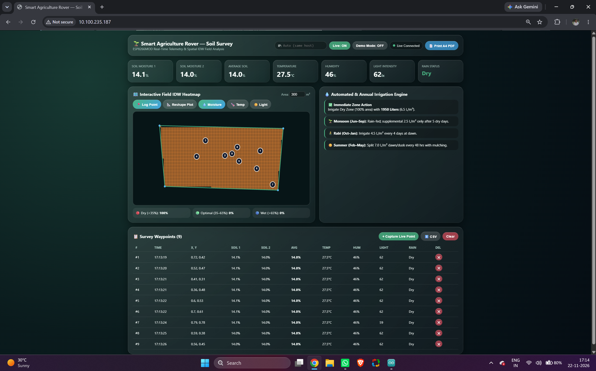

# 🌱 Smart Agriculture Rover — Environmental Telemetry & Spatial Soil Survey System

An IoT-enabled **Smart Agriculture Rover** environmental monitoring and spatial soil survey subsystem built on the **ESP8266MOD NodeMCU V3**. The system collects multi-sensor field telemetry (dual capacitive soil moisture probes, ambient temperature, relative humidity, light intensity, and rainfall detection), displays rotating field metrics on an onboard **16×2 I2C LCD**, and serves a **Liquid Glass Web Dashboard** featuring real-time Inverse Distance Weighting (IDW) spatial heatmaps, automated irrigation recommendations, CSV export, and A4 PDF report generation.

---

## 📸 1. Live System Demonstration & Screenshots

### Real-Time Web Dashboard & Baseline A4 Print Preview

| Initial Field Boundary View (`http://10.100.235.187`) | Baseline A4 Print Preview (Pre-Survey Plot) |
| :---: | :---: |
|  |  |
| *Live ESP8266MOD connection (`Live: ON`, `Demo Mode: OFF`), 7 sensor cards, and custom field polygon (`450 m²`).* | *Print-formatted A4 sheet preview showing live sensor readings, field boundary, and immediate irrigation action.* |

### A4 PDF Survey Report Export (`Print A4 PDF`)

| A4 Report Page 1 — Telemetry, IDW Map & Directives | A4 Report Page 2 — Seasonal Guide & Waypoint Table |
| :---: | :---: |
|  |  |
| *Print-formatted A4 sheet capturing live sensor readings, high-resolution IDW heatmap (9 waypoints), zone breakdown (`100% Dry <35%`), and immediate irrigation volume (`1950 Liters` at `6.5 L/m²`).* | *Continuation page containing the summer split-watering schedule and full timestamped 9-waypoint tabular log.* |

---

## 🚀 2. System Architecture & Key Features

- **Multi-Channel 16-Bit Analog Acquisition:** Uses an **ADS1115 (`0x48`)** I2C ADC to read two capacitive soil moisture sensors (`A0`, `A1`) and a YL-83 rain sensor (`A2`) simultaneously on the single-ADC ESP8266.
- **Shared I2C Sensor & Display Bus:** Combines the **ADS1115 (`0x48`)**, **BH1750 (`0x23`)** ambient light sensor, and **16×2 I2C LCD (`0x27`)** on two pins (`D2` SDA, `D1` SCL).
- **Digital Microclimate Sensing:** Reads ambient temperature (°C) and relative humidity (%) via a 3-pin **DHT22** module on `D5`.
- **Embedded Liquid Glass Web Server (`PROGMEM`):** Serves a compact, memory-safe web dashboard directly from the ESP8266MOD flash memory with `Live: ON` and `Demo Mode: ON/OFF` switching, polling `/data` every 2 seconds.
- **Interactive Field Polygon & IDW Heatmap:** Supports clicking inside the custom land boundary to log waypoints, reshaping plot vertices, switching between **Moisture**, **Temp**, and **Light** layers, and exporting survey data to `.csv`.
- **Agronomic & Annual Irrigation Engine:** Computes zone-by-zone water demand (`6.5 L/m²` deficit restoration), enforces a rain-delay lock when rainfall is detected, and provides Kharif, Rabi, and Zaid seasonal schedules.

---

## 🛠️ 3. Bill of Materials (Hardware)

| Component | Model / Variant | Interface / Address | Purpose |
| :--- | :--- | :--- | :--- |
| **Microcontroller** | ESP8266MOD NodeMCU V3 | Wi-Fi / I2C / GPIO | Main telemetry controller & web server |
| **16-Bit ADC Module** | ADS1115 (`HW-198`) | I2C (`0x48`) | Reads Soil 1, Soil 2, and Rain analog channels |
| **Soil Moisture Sensors (×2)** | Capacitive Soil Sensor V2.0.0 (`HW-390`) | Analog (`0–3.3V`) | Dual-zone root moisture measurement |
| **Temp & Humidity Sensor** | DHT22 (3-Pin PCB w/ pull-up) | Digital Single-Wire (`D5`) | Ambient temperature (°C) & relative humidity (%) |
| **Light Intensity Sensor** | BH1750 (`GY-302`) | I2C (`0x23`) | Ambient illuminance in Lux (`lx`) |
| **Rain Sensor** | YL-83 Plate + LM393 Comparator | Analog (`AO` → `A2`) | Rainfall detection & surface wetness percentage |
| **Onboard Display** | 16×2 Character LCD + PCF8574 Backpack | I2C (`0x27`) | 3-page rotating field display & IP readout |

---

## 🔌 4. Hardware Pinout

| Module | Module Pin | NodeMCU Pin | Notes |
| :--- | :--- | :--- | :--- |
| **ADS1115 (`HW-198`)** | `VDD` / `GND` / `ADDR` | `3V` / `G` / `G` | `ADDR` tied to `G` sets I2C address `0x48` |
| | `SCL` / `SDA` | `D1` / `D2` | Shared I2C bus (`GPIO5` / `GPIO4`) |
| | `A0` / `A1` / `A2` | Soil 1 / Soil 2 / Rain `AO` | `A3` left unconnected |
| **Soil Sensor 1 & 2** | `VCC` / `GND` / `AOUT` | `3V` / `G` / ADS `A0`, `A1` | 3.3V excitation |
| **Rain Sensor (`LM393`)** | `VCC` / `GND` / `AO` | `3V` / `G` / ADS `A2` | 3.3V excitation (`DO` unused) |
| **BH1750 (`GY-302`)** | `VCC` / `GND` / `ADO` | `3V` / `G` / `G` | `ADO` tied to `G` sets I2C address `0x23` |
| | `SCL` / `SDA` | `D1` / `D2` | Shared I2C bus |
| **DHT22 (3-Pin PCB)** | `+` / `-` / `OUT` | `3V` / `G` / `D5` | `GPIO14` |
| **16×2 I2C LCD** | `VCC` / `GND` | `VU` (5V) / `G` | I2C address `0x27` |
| | `SCL` / `SDA` | `D1` / `D2` | Shared I2C bus |

---

## 📁 5. Project Structure

```text
smart-agriculture-rover/
├── README.md
├── .gitignore
├── docs/
│   ├── dashboard_initial.jpg
│   ├── report_a4_blank_preview.jpg
│   ├── report_a4_page1_heatmap.jpg
│   └── report_a4_page2_waypoints.jpg
└── firmware/
    └── smart_agri_rover/
        └── smart_agri_rover.ino
```

---

## ⚙️ 6. Setup & Deployment

1. **Arduino IDE Configuration:**
   - Install the ESP8266 board package and select **Board:** `NodeMCU 1.0 (ESP-12E Module)` at `115200` baud.
   - Install libraries: `Adafruit ADS1X15`, `DHT sensor library`, `BH1750`, and `LiquidCrystal I2C`.
2. **Wi-Fi & Calibration:**
   - Open `firmware/smart_agri_rover/smart_agri_rover.ino` and configure your `ssid` and `password`.
   - Calibrate `SOIL1_DRY_RAW` / `SOIL1_WET_RAW`, `SOIL2_DRY_RAW` / `SOIL2_WET_RAW`, and `RAIN_DRY_RAW` / `RAIN_WET_RAW` using Serial Monitor (`115200` baud).
   - **Note:** Do not commit your actual Wi-Fi password or private credentials to GitHub.
3. **Access Dashboard:**
   - Upload the firmware, read the assigned IP address from the 16×2 LCD (e.g., `10.100.235.187`), and open `http://<IP_ADDRESS>/` in any browser on the same network.
   - Query `http://<IP_ADDRESS>/data` directly for raw JSON telemetry.

---

## 👨‍💻 Developer

**Manikantha Gowda**  
GitHub: [https://github.com/Mgfx05](https://github.com/Mgfx05)

---

*Smart Agriculture Rover – IoT-based Agricultural Monitoring & Spatial Soil Survey System.*